# Lecture 2 — Exercises

These exercises are designed to cover the main topics of Lecture 2.

## Exercise 1 — Functions, Cardinality and Countability

Consider the function

$$
f:\mathbb{N}\to A
$$

where

$$
A=\{2,4,6,8,\ldots\}
$$

and suppose $f$ is defined by

$$
f(n)=2n.
$$

1. Determine whether $f$ is injective, surjective, or bijective.
2. Explain what your answer tells us about the cardinality of $\mathbb{N}$ and $A$.
3. State what it means for two sets to be **equinumerous**.
4. Let

    $$
    B=\{1,2,3,4,5\}.
    $$

    Is $B$ finite, countably infinite, or countable? Explain.  

5. Is $A$ finite, countably infinite, or countable? Explain.  
6. In your own words, distinguish **finite**, **countably infinite**, and **countable**.

### Handwritten solution

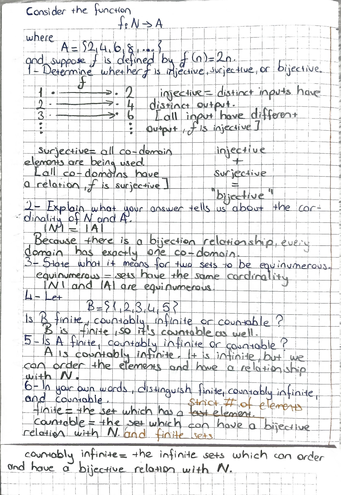

---

# Countability and Its Lemmas

## Exercise 2 — Lemma 1.0

Let

$$
A=\{2,4,6,8,\ldots\}.
$$

1. Construct an **injection** 
$
A\to\mathbb{N}.
$

2. Construct a **surjection**
$
\mathbb{N}\to A.
$

3. Use Lemma 1.0 to conclude that $A$ is countable.
4. Explain the intuition behind the two constructions: how does each one show that the elements of $A$ can be handled using $\mathbb{N}$?

### Handwritten solution

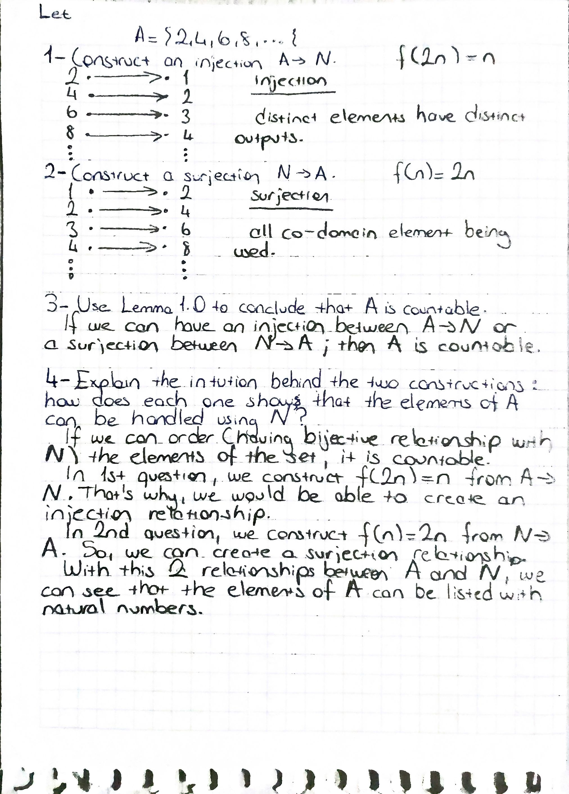

---

## Exercise 3 — Lemma 1.1

Let

$$
B=\mathbb{N}
$$

and let

$$
A=\{2,4,6,8,\ldots\}\subseteq B.
$$

1. Explain why $B$ is countable.
2. Verify that $A\subseteq B$.
3. Use **Lemma 1.1** to conclude that $A$ is countable.
4. Explain in your own words why being a subset of a countable set is enough to establish countability.

Then consider

$$
C=\{1,3,5,7,\ldots\}.
$$

Use the same lemma to determine whether $C$ is countable.

### Handwritten solution

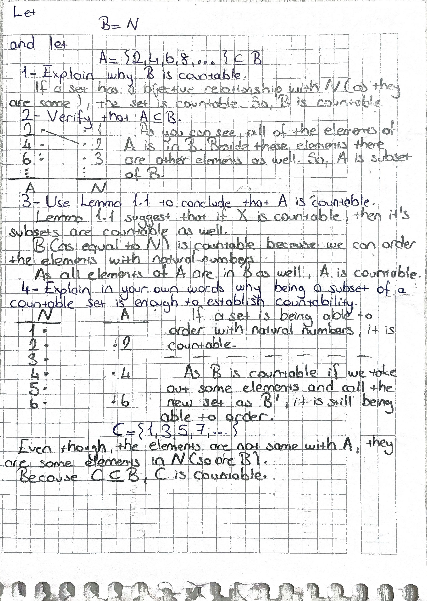

---

## Exercise 4 — Lemma 1.2

Let

$$
A_1=\{1,2,3\},\qquad
A_2=\{a,b\},\qquad
A_3=\{x,y,z,w\}.
$$

1. Determine
$
|A_1\cup A_2\cup A_3|.
$

2. Determine
$
|A_1\times A_2\times A_3|.
$

3. Explain why both sets are finite.
4. State how this example illustrates **Lemma 1.2**.
5. In general, if $A_1,\ldots,A_k$ are finite, what does Lemma 1.2 tell us about
$
A_1\cup\cdots\cup A_k
$
and
$
A_1\times\cdots\times A_k?
$

### Handwritten solution

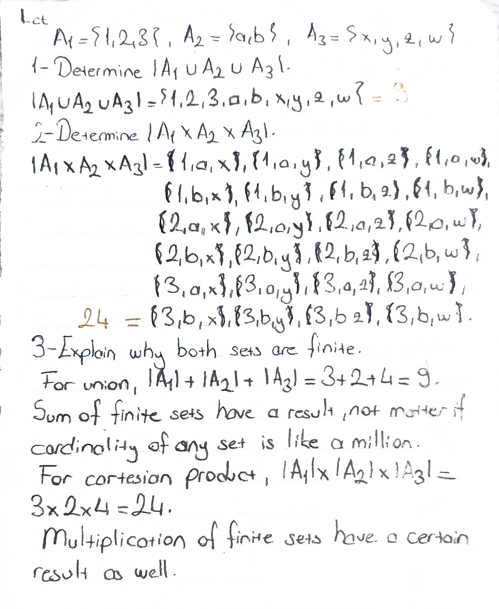
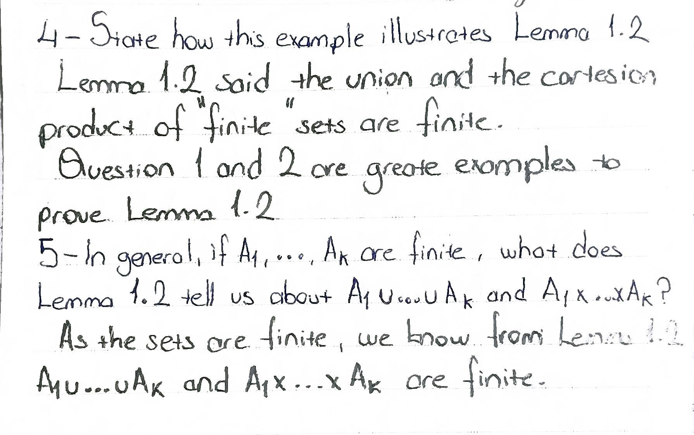

---

## Exercise 5 — Lemma 1.3 and the Countability of $\Sigma^*$

Let

$$
\Sigma=\{0,1\}.
$$

For every $k\in\mathbb{N}$, let $\Sigma^k$ be the set of all strings of length exactly $k$ over $\Sigma$.

1. Explain why every $\Sigma^k$ is finite.
2. Write down $\Sigma^0$, $\Sigma^1$, and $\Sigma^2$.
3. Express $\Sigma^*$ as a union of the sets $\Sigma^k$.
4. Apply **Lemma 1.3** to prove that $\Sigma^*$ is countable.
5. Explain why this result is an example of combining **infinitely many finite sets** while still obtaining a countable set.

### Handwritten solution

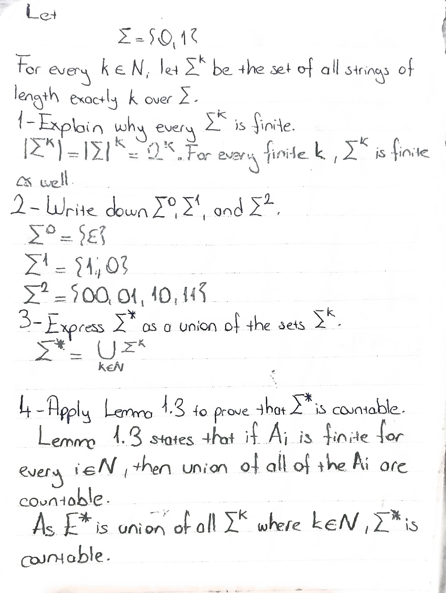
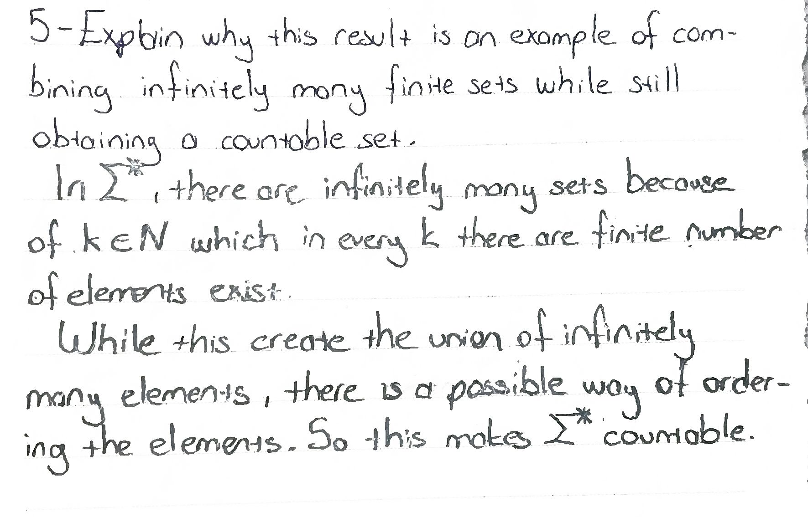

---

## Exercise 6 — Lemma 1.4 and Countable Cartesian Products

Let

$$
A=\mathbb{N}
\qquad\text{and}\qquad
B=\mathbb{N}.
$$

1. Explain why $A$ and $B$ are countable.
2. Use **Lemma 1.4** to conclude that
$
A\times B
$
is countable.

3. Draw a small grid representing the first few elements of
$
\mathbb{N}\times\mathbb{N}.
$

4. Show how the pairs can be systematically enumerated by traversing the grid.
5. Use this result to explain why
$
\mathbb{Z}\times\mathbb{Z}
$
is countable.

6. Finally, state the lecture's corollary concerning
$
\mathbb{Q}.
$
Briefly explain how the countability of a Cartesian product helps establish that result.

### Handwritten solution

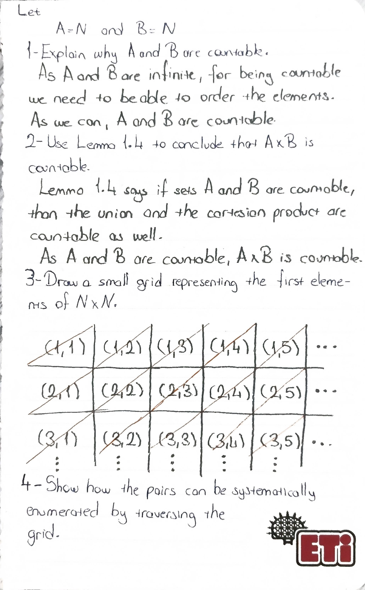
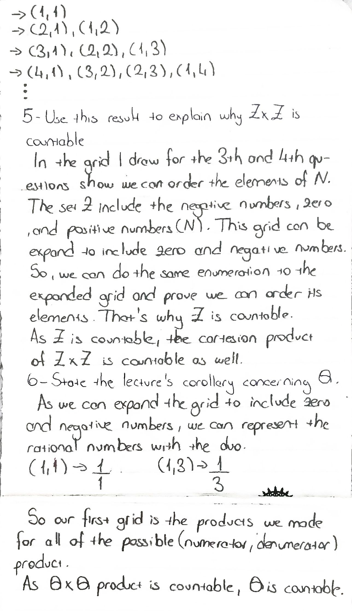

---

## Exercise 7 — Lemma 1.5 and Countable Unions

For every $i\in\mathbb{N}$, let

$$
A_i=\{(i,1),(i,2),(i,3),\ldots\}.
$$

1. Explain why each $A_i$ is countable.
2. Consider

$$
A=\bigcup_{i\in\mathbb{N}}A_i.
$$

Use **Lemma 1.5** to determine whether $A$ is countable.  
3. Explain how Lemma 1.5 generalizes Lemma 1.3.  
4. Describe the role of Lemma 1.5 in the overall chain of countability results from Lecture 2.

### Handwritten solution

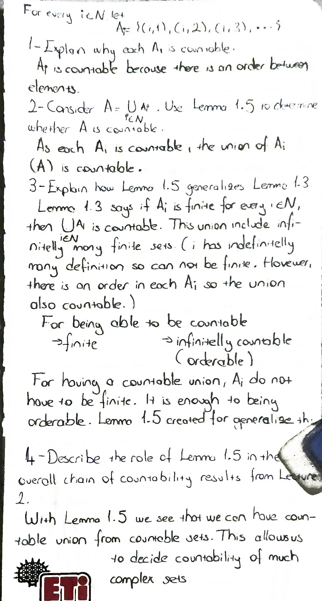

---

# Cantor Diagonalization, Strings and Languages

## Exercise 8 — Cantor Diagonalization, Alphabets, Strings and Languages

### Part A — Cantor Diagonalization

Suppose that all infinite binary sequences could be listed as

$$
\alpha_0,\alpha_1,\alpha_2,\ldots
$$

1. Explain how to arrange the sequences as rows of an infinite table.
2. Define a new sequence $\delta$ using

$$
\delta(i)=1-\alpha_i(i).
$$

3. Explain why $\delta$ differs from $\alpha_i$ at position $i$ for every $i$.
4. Explain why this proves that the proposed list cannot contain every infinite binary sequence.
5. State the conclusion about
$
2^{\mathbb{N}}.
$

6. State the lecture's corresponding conclusion about $\mathbb{R}$.

### Handwritten solution

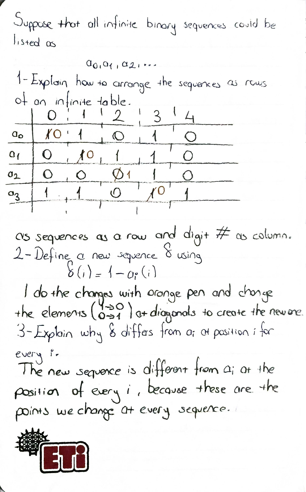
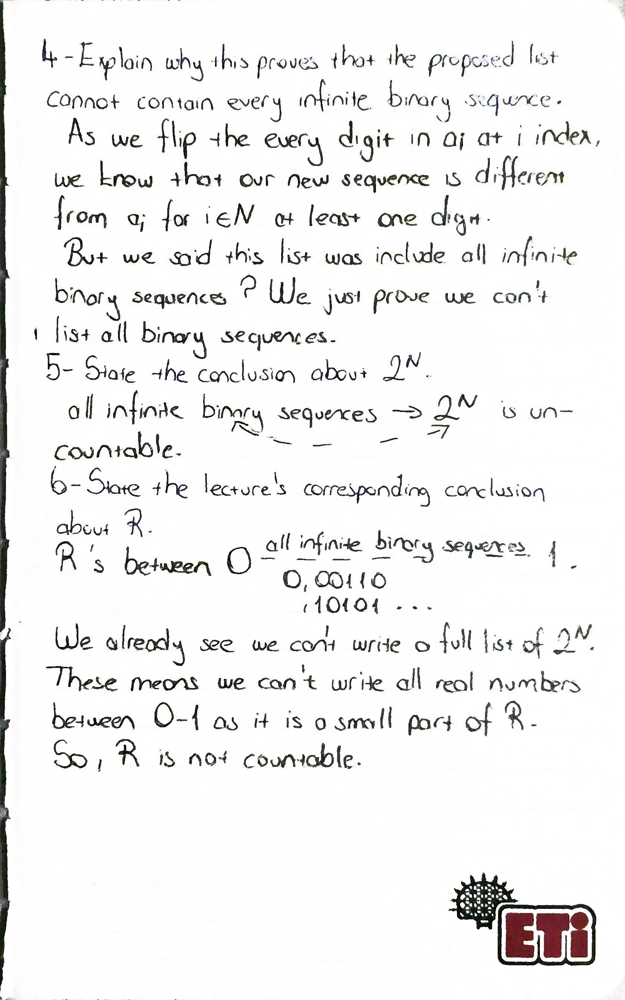

---

### Part B — Alphabets and Strings

Let

$$
\Sigma=\{a,b\}.
$$

1. Write down all elements of $\Sigma^2$.
2. Explain the difference between $\Sigma^k$, $\Sigma^*$, and $\Sigma^+$.
3. State where the empty word $\varepsilon$ belongs.
4. For

$$
u=ab,\qquad v=baa,
$$

compute $uv$ and $vu$.

5. For

$$
w=abbababa,
$$

determine $\#_a(w)$ and $\#_b(w)$.

### Handwritten solution

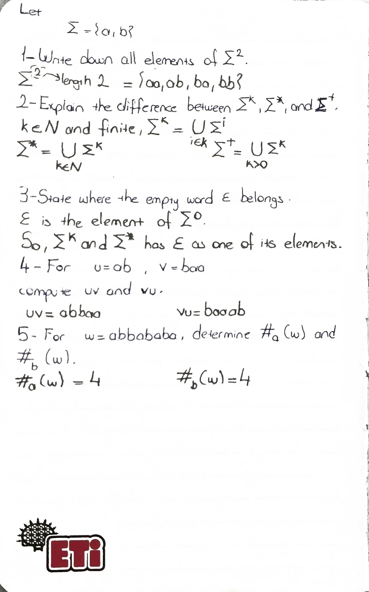

---

### Part C — Languages

Define

$$
L=\{w\in\Sigma^*\mid \#_a(w)=\#_b(w)\}.
$$

Determine whether each of the following belongs to $L$:

- $aabb$
- $ababa$
- $bbaa$
- $\varepsilon$
- $aaab$

For each one, justify your answer using the definition of $L$.

### Handwritten solution

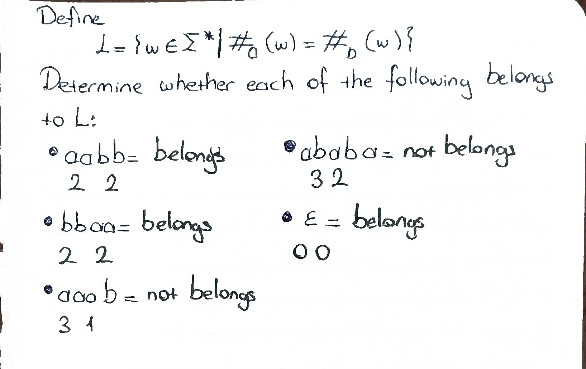

---

# Computing Mechanisms

## Exercise 9 — From Language Recognition to Computing Mechanisms

Consider the language

$$
L=\{w\in\{0,1\}^*\mid w\text{ contains an even number of }1\text{s}\}.
$$

### Part A — Simple Computing Scenario

1. Describe the simple computing scenario for an input string $w$.
2. What should the output be when $w\in L$?
3. What should the output be when $w\notin L$?

### Handwritten solution

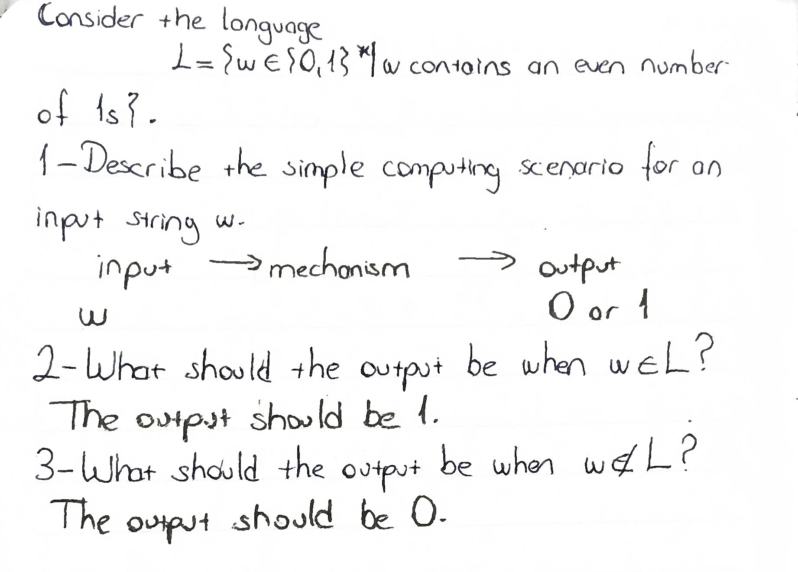

---

### Part B — Opening the Black Box

The lecture then describes an abstract computing mechanism.

Explain the role of each of the following:

- input tape,
- readhead,
- finite-state control,
- memory,
- computation rules.

Then explain what information a single computation step depends on and what can change after that step.

### Handwritten solution
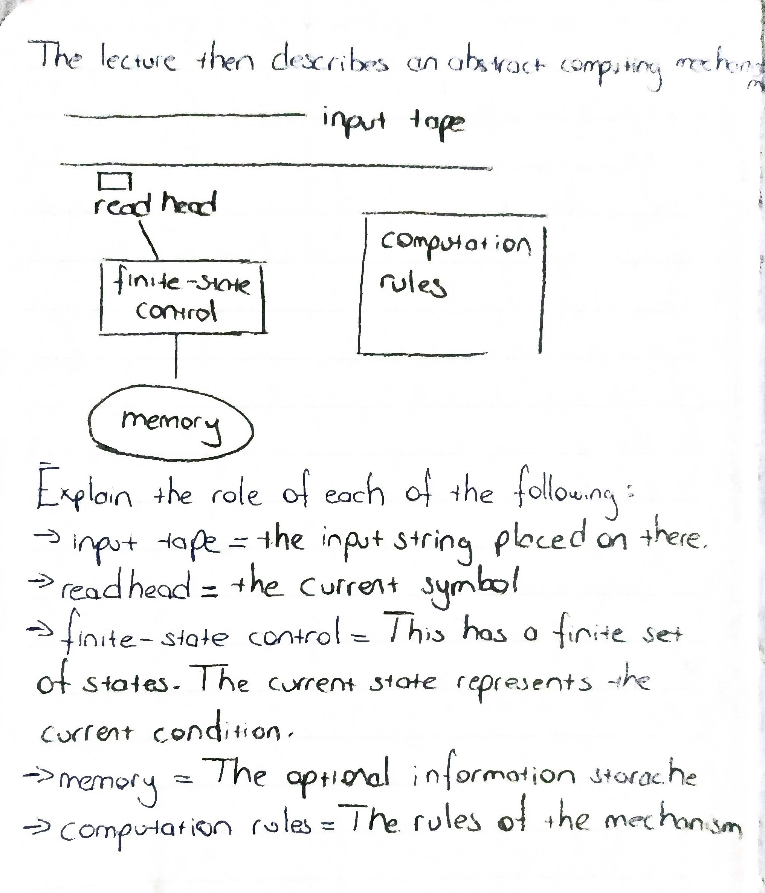
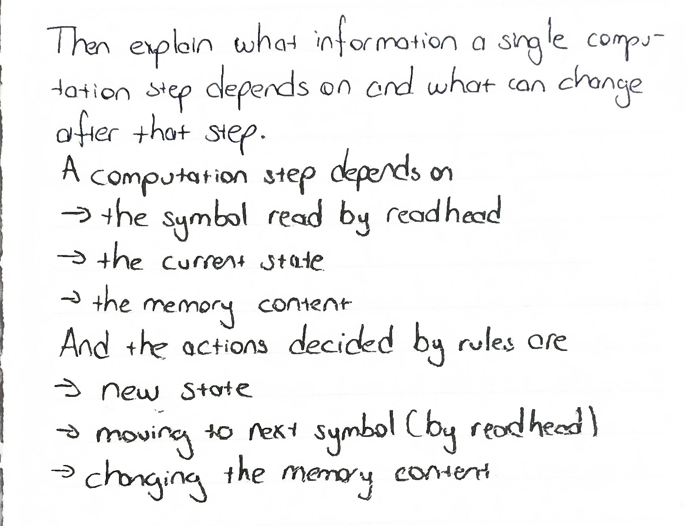

---

### Part C — Three Computing Mechanisms

Match each description with the appropriate model:

1. no separate memory;
2. tape memory with a read/write head;
3. tape memory with a read/write head that operates only at one end.

The three models are:

- Finite Automaton
- Turing Machine
- Pushdown Automaton

Finally, explain the main conceptual question introduced by these models:

> How does the available memory, and the way that memory can be accessed, affect which languages a computing mechanism can recognize?

### Handwritten solution

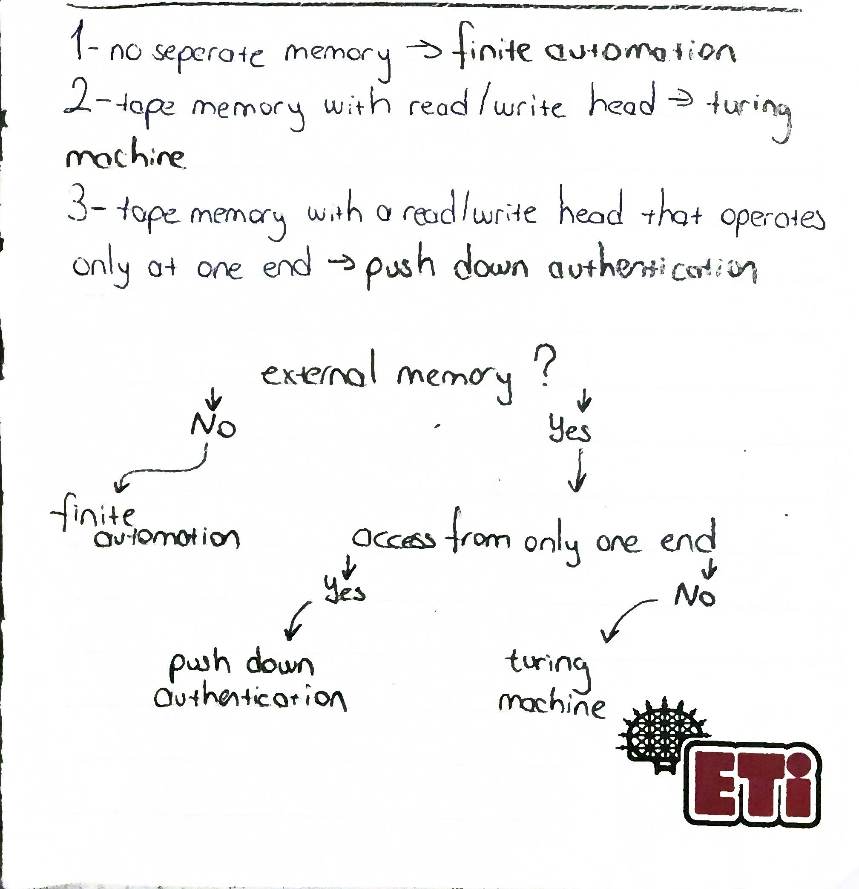

---

# Reflection

## 1. One concept I initially misunderstood

<!-- Describe one misconception and how you corrected it. -->
At first I thought $\varepsilon$ is included in any $\Sigma$. Like the $\emptyset$ is an element of all sets. Then I correct myself as $\varepsilon$ = $\Sigma^0$. If there is $\Sigma^0$, then there is $\varepsilon$.

## 2. Things I still have doubts about

<!-- Write the concept, proof, or intuition that is still unclear. -->
I am not sure exactly how the computing mechanism works. As new lecture will focus that topic, I aim to learn more about it in next lecture.

## Evidence

The handwritten solutions for the exercises can be included in the `images/` directory.
