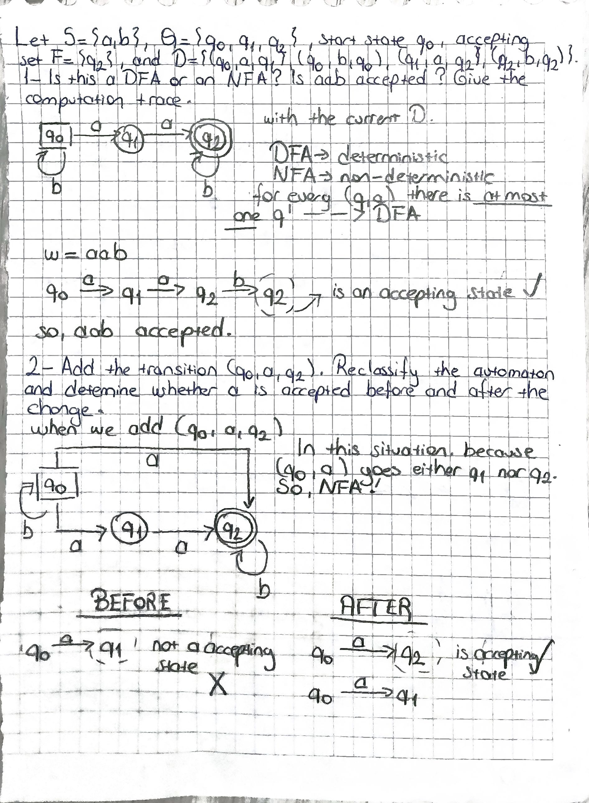
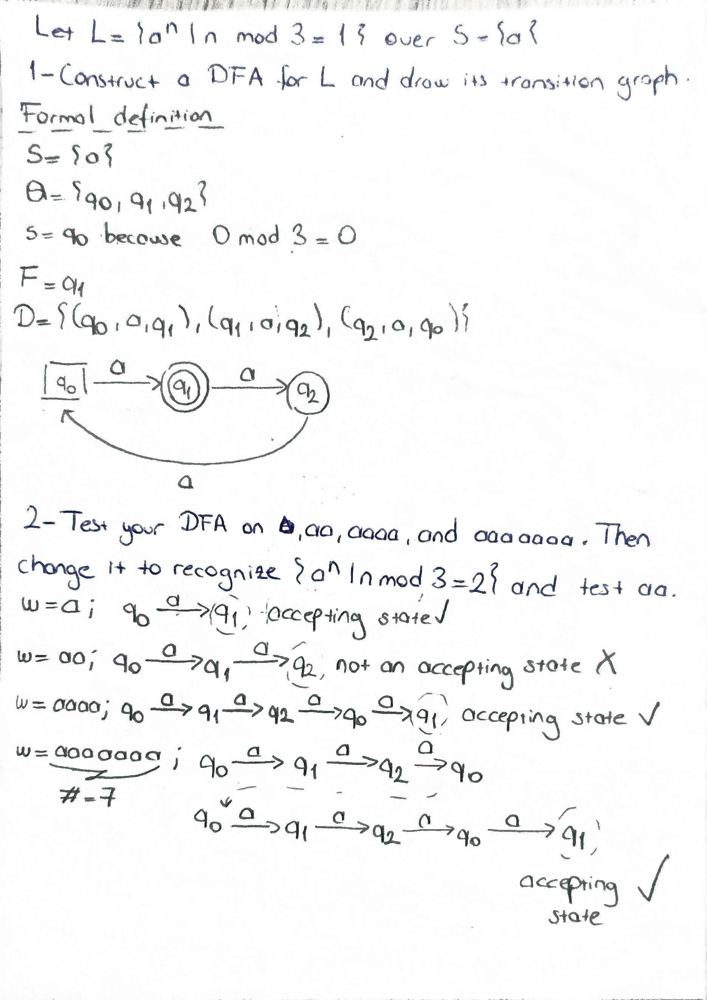
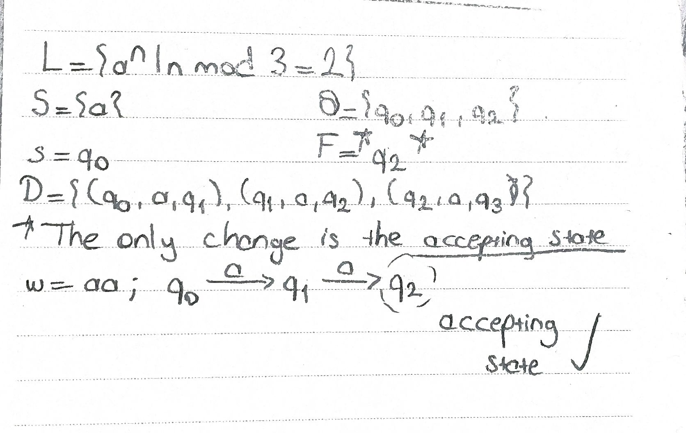
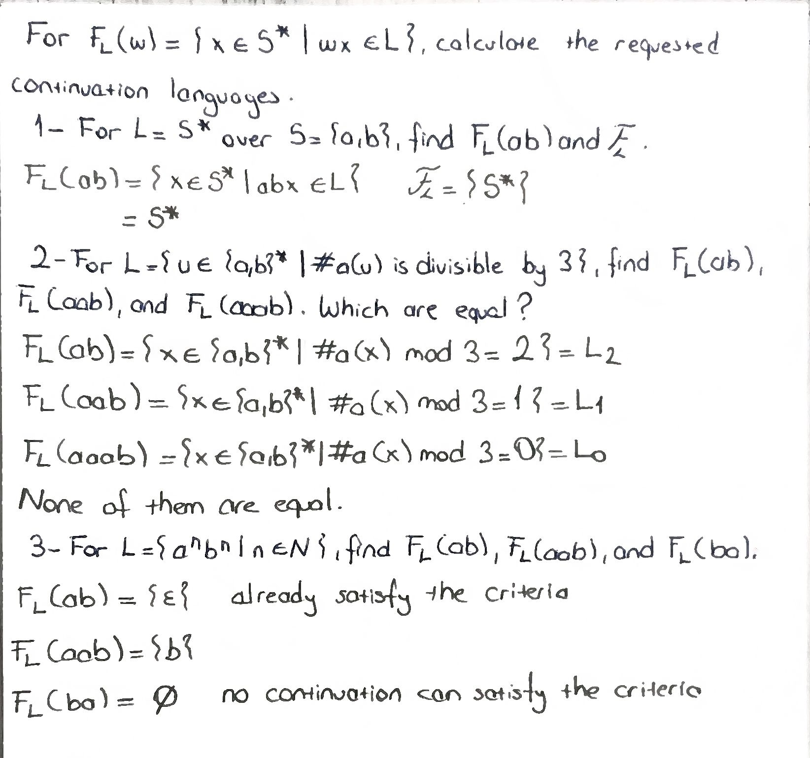
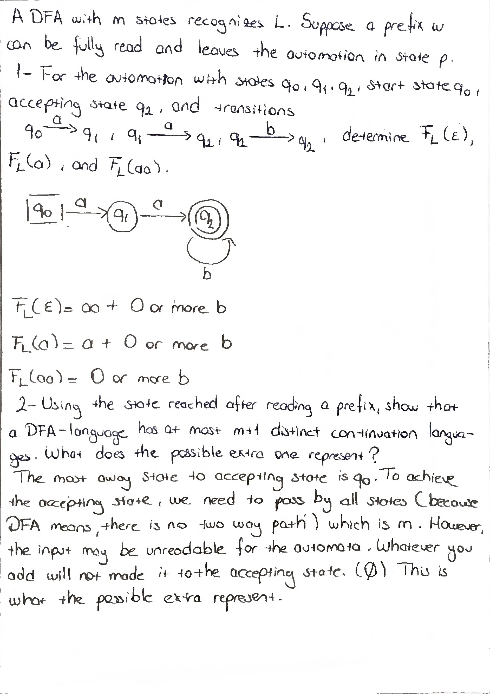
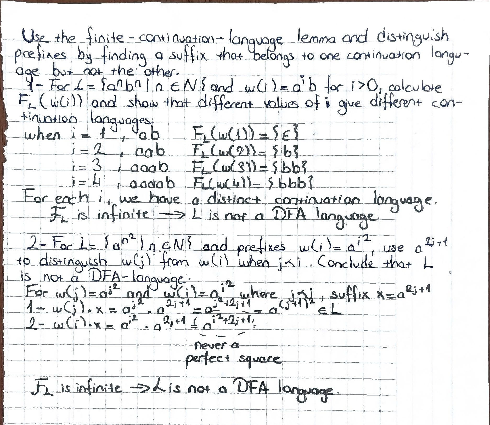

# Lecture 3 — Exercises

Apply the definitions and methods from `notes_3.md`. Show calculations or computation traces where needed. 

## Exercise 1 — Classifying and Running an Automaton

Let $S=\{a,b\}$, $Q=\{q_0,q_1,q_2\}$, start state $q_0$, accepting set $F=\{q_2\}$, and

$$
D=\{(q_0,a,q_1),(q_0,b,q_0),(q_1,a,q_2),(q_2,b,q_2)\}.
$$

1. Is this a DFA or an NFA? Is $aab$ accepted? Give the computation trace.
2. Add the transition $(q_0,a,q_2)$. Reclassify the automaton and determine whether $a$ is accepted before and after the change.

### Handwritten solution

---

## Exercise 2 — Constructing a DFA from a Language

Let $L=\{a^n\mid n\bmod 3=1\}$ over $S=\{a\}$.

1. Construct a DFA for $L$ and draw its transition graph.
2. Test your DFA on $a$, $aa$, $aaaa$, and $aaaaaaa$. Then change it to recognize $\{a^n\mid n\bmod 3=2\}$ and test $aa$.

### Handwritten solution

---

## Exercise 3 — Computing Continuation Languages

For $F_L(w)=\{x\in S^*\mid wx\in L\}$, calculate the requested continuation languages.

1. For $L=S^*$ over $S=\{a,b\}$, find $F_L(ab)$ and $\mathcal F_L$.
2. For $L=\{u\in\{a,b\}^*\mid \#a(u)\text{ is divisible by }3\}$, find $F_L(ab)$, $F_L(aab)$, and $F_L(aaab)$. Which are equal?
3. For $L=\{a^n b^n\mid n\in\mathbb N\}$, find $F_L(ab)$, $F_L(aab)$, and $F_L(ba)$.

### Handwritten solution

---

## Exercise 4 — Applying the Finite-Continuation-Language Lemma

A DFA with $m$ states recognizes $L$. Suppose a prefix $w$ can be fully read and leaves the automaton in state $p$.

1. For the automaton with states $q_0,q_1,q_2$, start state $q_0$, accepting state $q_2$, and transitions $q_0\xrightarrow{a}q_1$, $q_1\xrightarrow{a}q_2$, $q_2\xrightarrow{b}q_2$, determine $F_L(\varepsilon)$, $F_L(a)$, and $F_L(aa)$.
2. Using the state reached after reading a prefix, show that a DFA-language has at most $m+1$ distinct continuation languages. What does the possible extra one represent?

### Handwritten solution

---

## Exercise 5 — Proving a Language Is Not a DFA-Language

Use the finite-continuation-language lemma and distinguish prefixes by finding a suffix that belongs to one continuation language but not the other.

1. For $L=\{a^n b^n\mid n\in\mathbb N\}$ and $w(i)=a^i b$ for $i>0$, calculate $F_L(w(i))$ and show that different values of $i$ give different continuation languages.
2. For $L=\{a^{n^2}\mid n\in\mathbb N\}$ and prefixes $w(i)=a^{i^2}$, use $a^{2j+1}$ to distinguish $w(j)$ from $w(i)$ when $j<i$. Conclude that $L$ is not a DFA-language.

### Handwritten solution

---

## Exercise 6 — Prime-Length Language

Let $L=\{a^n\mid n\text{ is prime}\}$ and consider the prefixes $w(i)=a^{i!+1}$.

Use the factorial construction from the notes to explain how arbitrarily long runs of composite lengths can distinguish continuation languages. Then state how infinitely many distinct continuation languages imply that $L$ is not a DFA-language.
### Handwritten solution

---

---

# Reflection

## 1. One concept I initially misunderstood

## 2. Things I still have doubts about

<!-- Write the concept, proof, or intuition that is still unclear. -->
I am not comfortable with the proof on the examples and not sure how to improve it.

## Evidence

The handwritten solutions for the exercises can be included in the `images/` directory.
